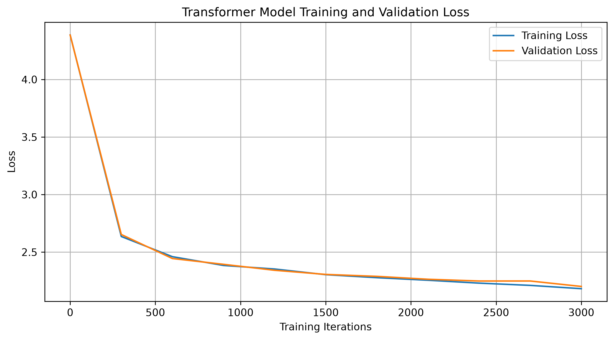

# MiniGPT-From-Scratch

### Building a GPT-Style Language Model from Scratch using PyTorch

## 📌 Project Overview

MiniGPT-From-Scratch is an educational Generative AI project focused on understanding and implementing the fundamental concepts behind GPT-style language models.

This project follows a step-by-step approach to building a small language model, starting from text preparation and tokenization to self-attention, multi-head attention, transformer decoder architecture, model training, and text generation.

The main objective is to understand how transformer-based language models work internally by implementing their core components using Python and PyTorch.

## 🎯 Project Objectives

- Understand text preprocessing and tokenization.
- Implement a Bigram Language Model.
- Understand and implement Self-Attention.
- Implement Multi-Head Attention.
- Build a Transformer Decoder architecture.
- Train a GPT-style language model using PyTorch.
- Generate text using the trained model.
- Evaluate model performance and experiment with generation parameters.

## 🛠️ Technologies Used

| Technology | Purpose |
|---|---|
| Python | Programming language |
| PyTorch | Deep learning and model implementation |
| NumPy | Numerical operations and data processing |
| Matplotlib | Training loss visualization |
| Jupyter Notebook | Step-by-step experimentation |

## 📂 Project Structure

```text
MiniGPT-From-Scratch/
│
├── data/
│   ├── input.txt
│   ├── tokenizer.json
│   ├── train_ids.npy
│   └── val_ids.npy
│
├── models/
│   ├── bigram_model.pth
│   └── transformer_decoder.pth
│
├── notebooks/
│   ├── 01_Data_Preparation_and_Tokenization.ipynb
│   ├── 02_Bigram_Language_Model.ipynb
│   ├── 03_Self_Attention.ipynb
│   ├── 04_Multi_Head_Attention.ipynb
│   ├── 05_Transformer_Decoder.ipynb
│   ├── 06_Model_Training.ipynb
│   ├── 07_Text_Generation.ipynb
│   └── 08_Model_Evaluation_and_Experiments.ipynb
│
├── outputs/
│   ├── generated_text.txt
│   ├── model_evaluation.json
│   ├── temperature_experiments.txt
│   ├── training_history.json
│   ├── training_loss.png
│   └── transformer_generated_text.txt
│
├── .gitignore
├── README.md
└── requirements.txt
```

## 🧠 Project Implementation

The project is divided into eight Jupyter notebooks.

### 1. Data Preparation and Tokenization

- Load and prepare the input text dataset.
- Convert text into numerical token IDs.
- Prepare training and validation datasets.
- Save tokenizer information and processed data.

### 2. Bigram Language Model

- Understand the fundamentals of language modeling.
- Implement a Bigram Language Model.
- Train the model to predict the next token based on the previous token.
- Save the trained model.

### 3. Self-Attention

- Understand the attention mechanism.
- Implement Query, Key, and Value concepts.
- Calculate attention scores.
- Understand how tokens interact with other tokens.

### 4. Multi-Head Attention

- Implement multiple attention heads.
- Combine information from different attention heads.
- Understand contextual representations.

### 5. Transformer Decoder

- Build the Transformer Decoder architecture.
- Combine attention and feed-forward layers.
- Implement the core components required for GPT-style language modeling.

### 6. Model Training

- Train the Transformer Decoder model.
- Monitor training and validation loss.
- Save model weights and training history.

### 7. Text Generation

- Load the trained Transformer model.
- Generate text using the trained model.
- Experiment with different generation settings.

### 8. Model Evaluation and Experiments

- Evaluate the trained language model.
- Analyze model performance.
- Experiment with different temperature values.
- Compare generated text outputs.

## 📊 Training Loss Visualization

The following graph represents the training progress of the Transformer Decoder model.



The training loss visualization helps monitor the model's learning process and understand how the loss changes during training.

## ✍️ Text Generation Results

The trained Transformer Decoder model generates text by predicting the next token based on previously generated tokens.

The project saves generated text outputs in the `outputs/` directory.

### Transformer Generated Text

The generated text from the trained Transformer Decoder model can be viewed here:

📄 [View Transformer Generated Text](outputs/transformer_generated_text.txt)

### Other Generated Text

📄 [View Generated Text](outputs/generated_text.txt)

### Generation Experiments

📄 [View Temperature Experiments](outputs/temperature_experiments.txt)

## 📁 Additional Model Results

| Output File | Description |
|---|---|
| `training_loss.png` | Training loss visualization |
| `training_history.json` | Training history |
| `model_evaluation.json` | Model evaluation results |
| `generated_text.txt` | Generated text output |
| `transformer_generated_text.txt` | Transformer-generated text |
| `temperature_experiments.txt` | Temperature experiment results |

## ⚙️ Installation and Setup

### Prerequisites

- Python 3.10 or above
- Jupyter Notebook or VS Code
- Basic understanding of Python

### Step 1: Clone the Repository

```bash
git clone https://github.com/koladiyaheena/MiniGPT-From-Scratch-.git
```

### Step 2: Navigate to the Project Directory

```bash
cd MiniGPT-From-Scratch-
```

### Step 3: Create a Virtual Environment

```bash
python -m venv minigpt
```

### Step 4: Activate the Virtual Environment

For Windows:

```bash
minigpt\Scripts\activate
```

### Step 5: Install Dependencies

```bash
pip install -r requirements.txt
```

### Step 6: Launch Jupyter Notebook

```bash
jupyter notebook
```

Open the `notebooks/` directory and execute the notebooks in numerical order.

## 📚 Key Concepts Learned

Through this project, I explored and implemented:

- Natural Language Processing (NLP)
- Tokenization and Text Processing
- Bigram Language Modeling
- Neural Networks using PyTorch
- Self-Attention Mechanism
- Query, Key, and Value
- Multi-Head Attention
- Transformer Decoder Architecture
- Model Training and Evaluation
- Autoregressive Text Generation
- Temperature-Based Text Generation

## 🚀 Future Improvements

- Experiment with different model configurations.
- Improve text generation quality.
- Explore larger datasets and vocabulary sizes.
- Experiment with additional training strategies.
- Compare different language model architectures.

## 👩‍💻 Author

**Heena Koladiya**

MCA Student | Aspiring AI/ML Engineer

Interested in Artificial Intelligence, Machine Learning, Deep Learning, and Generative AI.

**GitHub:** [koladiyaheena](https://github.com/koladiyaheena)

**Project Repository:** [MiniGPT-From-Scratch](https://github.com/koladiyaheena/MiniGPT-From-Scratch-)

---

⭐ If you find this project useful for learning the fundamentals of GPT-style language models, feel free to explore the notebooks and experiment with the implementation.